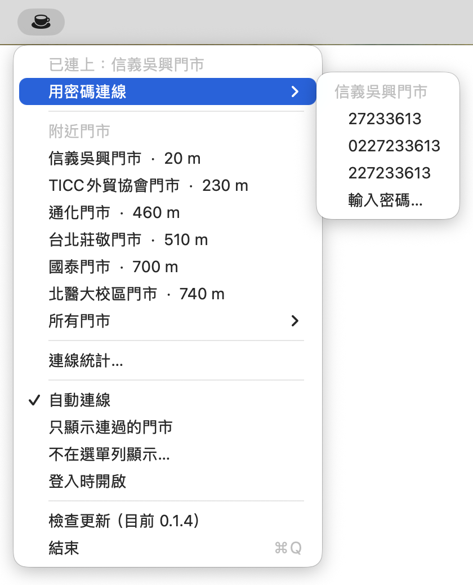
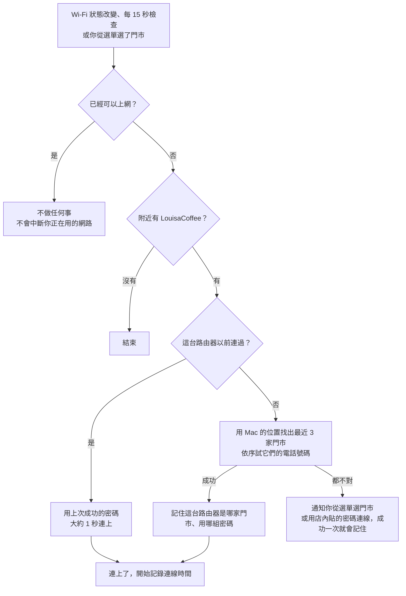

<p align="center"></p>

<h1 align="center">Louisa Wi-Fi</h1>

<p align="center">走進任何一家路易莎，Mac 自動連上 Wi-Fi。<br>不用問密碼，也不用一直「忘記這個網路」。</p>

<p align="center">
  <a href="https://github.com/madeyexz/louisa-wifi/releases/latest/download/LouisaWiFi.zip"><b>⬇️ 下載 Louisa Wi-Fi</b></a> ・
  <a href="#安裝">安裝教學</a> ・
  <a href="#常見問題">常見問題</a>
</p>

<p align="center"></p>
<p align="center"></p>

## 為什麼需要它？

每一家路易莎的 Wi-Fi 都叫 `LouisaCoffee`，但每家的密碼都不一樣（是那家店的電話號碼）。Mac 只會記住一組密碼，所以換一家店就連不上，得先「忘記這個網路」再重新輸入密碼。

Louisa Wi-Fi 會認出你在哪一家店，自動換上那家店的密碼。全台 500 多家門市的資料都已經內建。

## 它能做什麼

- ☕ **自動連線**：到了路易莎，打開 Mac 就會自動連上，什麼都不用做。
- 📍 **認得每一家店**：用位置找出最近的門市；連過一次的店，下次一秒就連上。
- 🔎 **手動選店**：萬一沒有自動連上，從選單列的 ☕ 點一下門市就好，也可以依縣市找。
- 🔑 **用密碼連線**：店裡都貼著 Wi-Fi 密碼，直接點那一組或自己輸入，不用等 app 一組一組試。
- 📊 **連線統計**：像 GitHub 的方格圖一樣，看你每天在路易莎待多久、最常去哪幾家、每個月去幾次。
- 🔄 **自動更新**：有新版本或新門市時，☕ 選單會提醒你，點一下就更新好。
- 🔒 **資料只在你的 Mac 上**：不需要帳號，不會上傳任何資料。

<p align="center"><br><sub>連線統計：點方格看當天去了哪家，下方可以切換門市、月份、年份。</sub></p>

## 安裝

需要 macOS 13（Ventura）或更新的版本。

**1. 下載**

👉 **[點這裡下載 Louisa Wi-Fi](https://github.com/madeyexz/louisa-wifi/releases/latest/download/LouisaWiFi.zip)**

**2. 放進「應用程式」**

打開「下載項目」資料夾，把 **LouisaWiFi** 拖進「應用程式」。如果看到的是 `LouisaWiFi.zip`，先點兩下解壓縮。

**3. 第一次打開**

到「應用程式」點兩下 **LouisaWiFi**。macOS 會跳出「無法打開」或「無法驗證開發者」的警告，這是因為 app 沒有付費向 Apple 註冊，不是病毒：

1. 先按「完成」關掉警告。
2. 打開「系統設定 → 隱私權與安全性」，捲到最下面。
3. 會看到「已阻擋 LouisaWiFi」，按旁邊的「**仍要打開**」（有些版本叫「強制打開」），輸入 Mac 的密碼。

只有第一次需要這樣做。

**4. 允許定位**

畫面右上角的選單列會出現 ☕，並跳出詢問是否允許使用你的位置，請按「**允許**」。

> 如果沒有跳出詢問，或不小心按了拒絕：打開「系統設定 → 隱私權與安全性 → 定位服務」，把 **LouisaWiFi** 打開。

完成！建議從 ☕ 選單勾選「**登入時開啟**」，這樣每次開機都會自動執行。

<details>
<summary>熟悉終端機？一行指令安裝（可以跳過第 3 步的安全性警告）</summary>

```sh
curl -fsSL https://raw.githubusercontent.com/madeyexz/louisa-wifi/main/install.sh | bash
```
</details>

## 怎麼用

**什麼都不用做。** 到了路易莎，Mac 就會自動連上，連上時會跳出通知，例如「已連上：信義吳興門市」。

點選單列的 ☕ 可以：

- 看現在連到哪一家
- 從「用密碼連線」直接選最近那家店張貼的那組密碼，或選「輸入密碼…」自己輸入
- 從「附近門市」點一下門市，自動嘗試它的密碼
- 從「所有門市」依縣市找到門市，選「自動嘗試」或其中一組密碼
- 打開「連線統計…」
- 開關「自動連線」「只顯示連過的門市」「登入時開啟」
- 選「不在選單列顯示…」把 ☕ 藏起來（app 仍會在背景自動連線）
- 檢查更新

## 它是怎麼運作的



重點在「記住路由器」：同一家店只要成功連過一次，之後不管定位準不準，看到那台路由器就直接用對的密碼。

## 常見問題

<details>
<summary>為什麼需要定位權限？</summary>

兩個原因：用你的位置找出最近的門市；另外，macOS 規定 app 要有定位權限，才能讀取 Wi-Fi 名稱和路由器資訊。位置資料只在你的 Mac 上使用，不會傳到任何地方。
</details>

<details>
<summary>到了路易莎但沒有自動連上？</summary>

點選單列的 ☕，從「附近門市」點你所在的那一家，或從「所有門市」找到它再選「自動嘗試」。選過一次之後，下次到這家店就會自動連上。

Mac 沒有 GPS，沒有網路時位置可能不準，所以第一次去某家店偶爾需要手動選一次。

如果自動嘗試太慢或都不對，看一下店內張貼的 Wi-Fi 密碼，從「用密碼連線」點那一組，或選「輸入密碼…」自己輸入；定位不準時，到「所有門市」找到那家店，同樣可以選密碼。這會中斷正在進行的嘗試，只用你選的密碼。
</details>

<details>
<summary>密碼是怎麼來的？</summary>

路易莎的 Wi-Fi 密碼是門市的電話號碼（通常去掉開頭的 0；台北 02 開頭的門市去掉整個 02；少數門市使用完整號碼）。門市和電話資料來自[路易莎官網的門市查詢](https://www.louisacoffee.co/visit)。
</details>

<details>
<summary>會不會打斷我正在用的網路？</summary>

不會。只要你已經可以上網（例如連著手機熱點），app 就不會去切換 Wi-Fi。
</details>

<details>
<summary>更新後又跳出定位詢問？</summary>

這是正常的。app 沒有付費向 Apple 註冊開發者簽章，所以每次更新後，macOS 會把它當成新的 app，再問一次定位權限。按「允許」就好，你的連線紀錄和統計都會保留。
</details>

<details>
<summary>把 ☕ 藏起來之後，要怎麼叫回來？</summary>

到「應用程式」（或用 Spotlight 搜尋 LouisaWiFi）再打開一次 app，☕ 就會回到選單列。藏起來的期間，app 還是會照常自動連線、記錄時間。
</details>

<details>
<summary>怎麼移除？</summary>

1. 點 ☕ → 結束。（如果 ☕ 被藏起來了，先照上一題把它叫回來。）
2. 把「應用程式」裡的 **LouisaWiFi** 丟到垃圾桶。
3. （選擇性）刪除紀錄：在 Finder 按 `⌘⇧G`，輸入 `~/Library/Application Support/LouisaWiFi`，刪掉這個資料夾。
</details>

---

## 進階

### Raycast

[`raycast/louisa-wifi.js`](raycast/louisa-wifi.js) 是一個 Raycast Script Command：

- 輸入門市名稱或地址關鍵字（例如 `延平`、`大安 復興`）。如果有多家符合，會顯示清單供你選擇。
- 留空即可連線到最近的門市（需安裝 app）。
- 已安裝 app 時，會透過 app 連線；未安裝時，則使用 `networksetup` 連線，所以只裝 Raycast 也能用。

安裝方式：從 [Releases](https://github.com/madeyexz/louisa-wifi/releases/latest) 下載 `louisa-wifi.js`，放進一個資料夾，再到 Raycast → Settings → Extensions → Script Commands → Add Directories 加入那個資料夾。

### 密碼規則

路易莎官方沒有統一的密碼規則，所以 app 從電話號碼產生 2 到 3 組候選密碼，依序嘗試：

| 電話 | 依序嘗試 |
|---|---|
| 02-2361-0718 | `23610718` → `0223610718` → `223610718` |
| 04-2326-2617 | `423262617` → `0423262617` → `23262617` |
| 03-338-0980 | `33380980` → `033380980` |

1. **去掉開頭的 0**（台北 02 開頭的門市去掉整個 02）：絕大多數門市用這組。
2. **保留開頭 0 的完整號碼**：例如新竹關新直營門市（03-577-0157 → `035770157`，見 [#1](https://github.com/madeyexz/louisa-wifi/issues/1)）。
3. **其他寫法**：台北門市只去掉 0、保留 2（`223610718`），或其他 10 碼號碼的後 8 碼（`23262617`）。9 碼號碼（03、05、06 等開頭）去掉 0 後就是後 8 碼，所以只有 2 組。

其他處理方式：

- 有分機（`#12`、`分機`、`轉`）或多支電話時，只取第一支電話的號碼。
- 每組錯的密碼要 15 到 20 秒才會失敗，所以候選最多 3 組。
- 成功連上後會記住這台路由器用的密碼，下次直接使用，不會再試。
- 密碼不是電話號碼，或候選都不對時，從「用密碼連線」或「所有門市」裡的門市選「輸入密碼…」，照店內張貼的密碼輸入。

與 [Watermelon-1234/LouisaInternetSwitch](https://github.com/Watermelon-1234/LouisaInternetSwitch) 整理的資料比對後，雙方都有收錄的 459 家門市中，有 454 家的密碼在候選之中；其餘 5 家用的是和官網電話不同的號碼。

### 門市資料

[`data/stores.json`](data/stores.json) 由 [`scripts/fetch_stores.py`](scripts/fetch_stores.py) 從官網抓取，包含名稱、地址、電話、經緯度和候選密碼。GitHub Actions 每週自動重新抓取一次；有變更時會自動發布新版本，app 會提示更新。

部分門市在官網上未提供電話，因此未收錄；另有部分門市缺少經緯度，需要手動選擇，或在 Raycast 中用名稱或地址搜尋。

### 自己編譯

只需要 Xcode Command Line Tools（`xcode-select --install`）：

```sh
./build.sh          # 產生 build/LouisaWiFi.app 和 build/LouisaWiFi.zip
open build/LouisaWiFi.app
```

將 `v*` 標籤推送到 GitHub 後，GitHub Actions 就會編譯並發布 Release。

### 隱私

連線與使用紀錄都儲存在你的 Mac 上：連過的路由器與密碼存放在 `~/Library/Application Support/LouisaWiFi/learned.json`，時間紀錄則存放在同一個資料夾的 `usage.json`。app 只會連到 `captive.apple.com`（確認網路是否可用）和 GitHub（檢查及下載更新）。

## 授權

MIT
